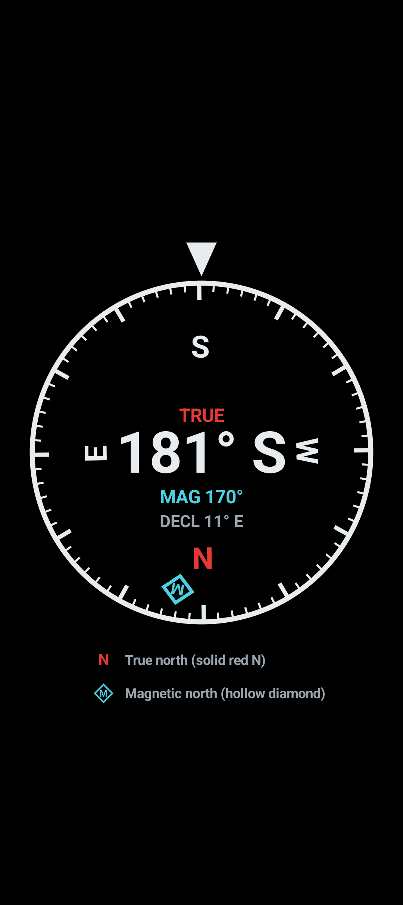
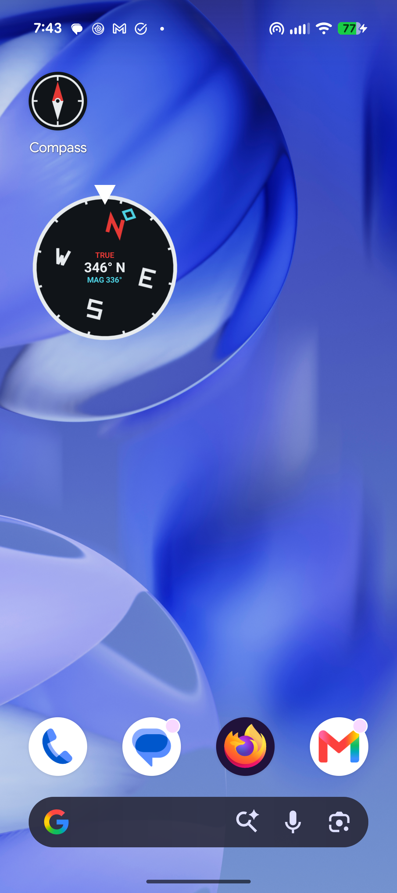
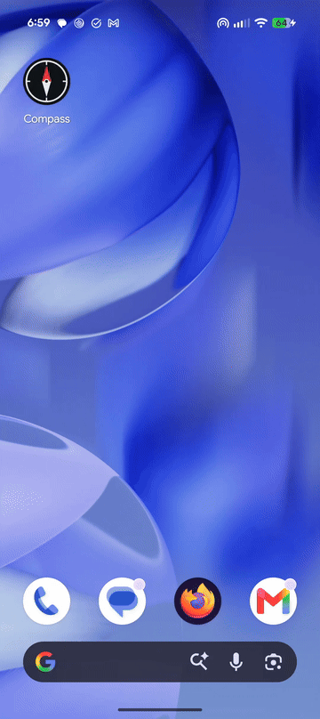

# Simple Android Compass


A simple, free compass for Android with **no ads, no tracking, and no internet access**. It has a full-screen compass and a live home-screen widget that spins as you turn. It shows **true north** as the main reading, with **magnetic north** overlaid so you can see the difference.

<p align="center">
  
</p>

## Why I built this

I couldn't find a decent free compass app that didn't come with ads, and Pixel phones don't ship with a stock compass app the way iPhones do. So I made one: a compass, a widget, and nothing else.

## Features

- **Full-screen compass** with a rotating dial, a heading readout (`273° W`), and a fixed pointer showing the way you face.
- **True north is the main reading.** The red **N** on the dial is true north.
- **Magnetic north overlay.** A hollow cyan **diamond** marks magnetic north. The gap between the two is the magnetic declination, shown as text too (`DECL 10° E`).
- **Live home-screen widget** (2×2, resizable) with the same dial, so you can check direction without opening the app.
- **Round adaptive launcher icon** shaped like a compass.
- **Private by design.** The only optional permission is approximate location, used on-device to calculate declination. Nothing is sent anywhere, and the app doesn't request internet access at all.
- **No third-party libraries.** Plain Android framework APIs and Kotlin.

## Screenshots

| Full-screen app | Widget on the home screen |
|---|---|
|  |  |

**Adding the widget and waking it up the first time:**

<p align="center">
  
</p>

## Reading the compass

| | True north (main) | Magnetic north |
|---|---|---|
| **On the dial** | Solid red **N** | Hollow cyan **diamond** (with an **M** in the full-screen app) |
| **Text** | `TRUE` and the big heading, e.g. `273° W` | `MAG 283°` and `DECL 10° E` |

The fixed white pointer at the top is the direction you're facing.

If location isn't allowed, the compass falls back to magnetic north only and says so (`MAGNETIC` in the app, `MAG ONLY` on the widget).

### What is declination?

A compass sensor finds **magnetic** north, which isn't the same as **true** (geographic) north, the direction maps and GPS use. The angle between them is the declination. It depends on where you are (about 10° east in Salt Lake City, roughly 0° in parts of the Midwest, much more in some places) and it drifts slowly over the years.

```
true heading = magnetic heading + declination      (declination: east is positive)
```

## Install

### Option 1: download the APK

1. Download the APK from the [Releases](../../releases) page (if one is published).
2. Open it on your phone. Android will ask you to allow installs from that app (your browser or Files app). Allow it, then tap **Install**.
3. If Play Protect warns about an unknown app, choose **Install anyway**.

### Option 2: build and run it yourself

Requirements: [Android Studio](https://developer.android.com/studio) (it bundles the SDK and a JDK 17).

1. Clone the repo and open the folder in Android Studio.
2. Let Gradle sync finish. The first sync downloads a lot.
3. Plug in your phone with USB debugging on (or start an emulator that has sensors) and press **Run**.

To produce an APK instead, use **Build → Generate App Bundles or APKs → Generate APKs**. The file lands in `app/build/outputs/apk/debug/app-debug.apk`.

From the command line with the platform tools:

```
adb install -r app/build/outputs/apk/debug/app-debug.apk
```

> **Heads up:** the Gradle wrapper scripts (`gradlew`) aren't committed, only `gradle/wrapper/gradle-wrapper.properties`. Android Studio handles this for you. For command-line builds, run `gradle wrapper` once with a local Gradle install, then `./gradlew assembleDebug`.

## First-time setup

1. **Open the Compass app once.** It asks for location permission. Choose **Approximate**. This is only used to work out the declination on your phone. Deny it and you still get a working magnetic compass.
2. **Add the widget.** Long-press an empty spot on the home screen, tap **Widgets**, find **Compass**, and drag it out. Long-press the widget afterwards to resize it.
3. **Tap the widget once** if the dial doesn't move. Android can block apps from starting background services while you're on the home screen, and opening the app fixes it. After that, the widget keeps following you.

### Tips

- **Calibrate.** If the heading looks off, wave the phone in a figure-eight a few times. Keep it away from magnets, speaker magnets, magnetic cases, and big metal objects.
- **Hide the notification.** The widget runs a foreground service, which Android requires to show a quiet "Compass widget running" notification. Long-press it, open its settings, and turn off the **Compass widget** category. The widget keeps working.
- **Battery.** The service reads the sensor only while the screen is on, so it costs almost nothing in your pocket. If your phone's battery manager kills it (some Samsung, Xiaomi and OnePlus builds do), set **Settings → Apps → Compass → Battery** to **Unrestricted**.
- **After a long trip,** open the app once so the declination refreshes. The widget uses the last saved value.

## How it works

### Heading

- The app reads `Sensor.TYPE_ROTATION_VECTOR`, the phone's fused orientation sensor, which combines the magnetometer, accelerometer and gyroscope and handles tilt for you.
- `SensorManager.getRotationMatrixFromVector` and `getOrientation` turn it into an azimuth, which is the **magnetic** heading.
- When the phone is held upright (pitch past about 57°), it remaps the axes (`remapCoordinateSystem`) so the heading follows where the back camera points instead of jumping around.
- A low-pass filter smooths the jitter, with the wraparound handled so crossing 359° → 0° doesn't spin the dial backwards. This logic lives in `HeadingTracker.kt`.

### True north

`Declination.kt` takes the last known approximate location (the coarse location permission is enough), computes declination offline with Android's built-in `GeomagneticField` World Magnetic Model, and stores it in `SharedPreferences`. On Android 11+ it falls back to a one-time network location fix when there's no cached location. Nothing leaves the device.

### The widget

Widgets use `RemoteViews`, which can't run custom drawing code or rotate arbitrary views, so the dial is a `RotateDrawable`. The widget only changes its level, which is cheap to send to the launcher:

```kotlin
// 0..10000 maps to 0..360 degrees; the dial turns opposite to the phone
views.setInt(R.id.dial, "setImageLevel", level(-trueHeading))
// the magnetic marker sits `declination` degrees clockwise of true north on the dial
views.setInt(R.id.mag_marker, "setImageLevel", level(declination - trueHeading))
appWidgetManager.partiallyUpdateAppWidget(ids, views)
```

`CompassService` is a foreground service (`specialUse` type) that listens to the sensor and pushes updates, but only when the screen is on, only when the heading changed by at least 1°, and at most about 12 times a second. A boot receiver restarts it after a reboot, and a `SharedPreferences` listener updates the widget straight away when the declination changes.

## Project structure

```
app/src/main/
├── AndroidManifest.xml
├── kotlin/com/ian/compass/
│   ├── MainActivity.kt      Full-screen immersive activity, sensor + permission handling
│   ├── CompassView.kt       Custom Canvas view that draws the dial, markers and legend
│   ├── HeadingTracker.kt    Sensor values -> smoothed magnetic heading
│   ├── Declination.kt       Location -> declination, cached in SharedPreferences
│   ├── CompassWidget.kt     AppWidgetProvider and RemoteViews updates
│   ├── CompassService.kt    Foreground service that feeds the widget
│   └── BootReceiver.kt      Restarts the service after reboot
└── res/
    ├── drawable/            Launcher icon foreground, widget dial and marker vectors
    ├── layout/              widget_compass.xml
    ├── mipmap-anydpi-v26/   Adaptive launcher icon
    ├── values/              Theme
    └── xml/                 Widget provider info
```

## Permissions

| Permission | Why |
|---|---|
| `ACCESS_COARSE_LOCATION` | Optional. Approximate location to calculate declination (true north). |
| `FOREGROUND_SERVICE`, `FOREGROUND_SERVICE_SPECIAL_USE` | Keeps the widget updating. |
| `RECEIVE_BOOT_COMPLETED` | Restarts the widget service after a reboot. |

No `INTERNET` permission, no analytics, no ads.

## Tech

- Kotlin 1.9, Android Gradle Plugin 8.5, Gradle 8.7, JDK 17
- `minSdk` 26 (Android 8.0), `targetSdk` / `compileSdk` 34
- No external dependencies

## Known limitations

- **The launcher icon can't spin.** Android launcher icons are static images, which is what the widget is for.
- Developed and tested on a Pixel 9. Other devices should work if they have a rotation-vector (compass) sensor. Without one, the app says so.
- Portrait only.
- Magnetic interference from cases, magnets, cars, and steel buildings will throw off any phone compass. Treat it as a convenience tool, not a navigation or safety device.
- Declination is refreshed when the app is opened, not in the background.
- Some phone makers aggressively kill background services, which can freeze the widget (see the battery tip above).
- The release build type is signed with the debug key so it can be sideloaded easily. That's fine for personal use, but not for publishing to the Play Store.

## Ideas for later

- [ ] Light theme and dial color options
- [ ] Lock or save a bearing
- [ ] Optional compass accuracy and calibration warning
- [ ] Larger widget layout with more detail

Pull requests and issues are welcome.

## License

[MIT](LICENSE)
